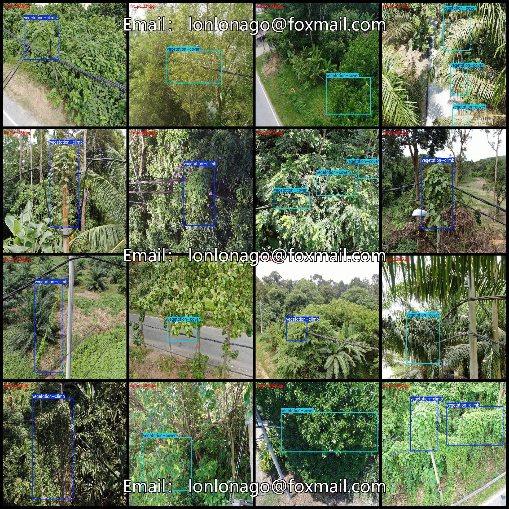
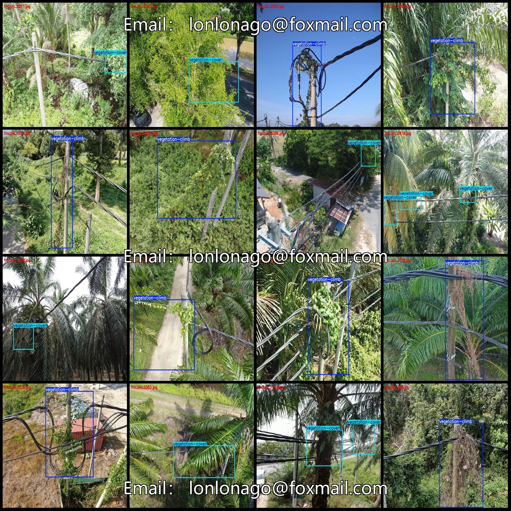

# Power Scene Transmission Line Tower Vegetation Covered Tendril Hazard Detection Data Set VOC+YOL

## Body

Power Scene Transmission Line Tower Vegetation Coverage Trunk Rope Hazard Detection Dataset VOC+YOLO format with 3992 images in 2 categories
Warm Reminder: Due to the dataset's replicability, please confirm compliance before purchasing.
Dataset format: Pascal VOC format + YOLO format (txt file without split path, only containing jpg images and corresponding VOC format xml files and yolo format txt files)
Number of images (number of jpg files): 3992
Number of annotations (number of xml files): 3992
Number of annotations (number of txt files): 3992
Number of annotation categories: 2

Annotation Category Names (Note that the order of categories in the Yolo format does not correspond to this, but is based on the classes.txt file in the labels folder): ["vegetation-climb", "vegetation-cover"]
Number of boxes per category
vegetation-climb (vegetation climbing towards pole tower) = 2186
vegetation-cover (vegetation covering power lines) = 2581
Total number of boxes: 4767
Number of images per category
vegetation-climb (vegetation climbing towards pole tower) = 2000

Vegetation-cover (vegetation obstructing power lines) occupies = 1992
Image resolution: 1024x768
Labeling tool used: labelImg
Labeling rules: Draw a rectangle around the category.
Important note: The dataset does not have separate training, validation, and test sets; you need to partition them yourself.
Special statement: This dataset does not guarantee the accuracy of the trained models or weight files.

## Images

## Payment

Here is a pay link on Stripe ( https://buy.stripe.com/3cs8yP7sY87d0vu9AB ). Please contact me lonlonago@foxmail.com after funding $89, and I will send you a complete data files , thank you!

